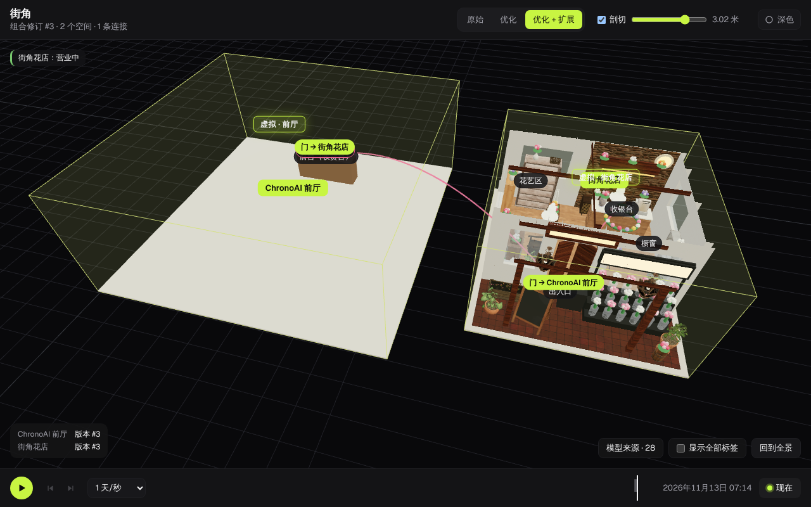

# 订花流程

来宾在花店订一份花，送到 ChronoAI 前厅：谁做什么、写哪条事件、页面上看到什么，以及怎么在本地跑通、上线前要准备什么。流程只用平台已有的机制（设计 5.3 现实事件、5.4 事件类型、11 数据接入、12 跨空间路线），不改网站和接口服务。



## 角色

| 角色 | 是谁 | 做什么 |
|---|---|---|
| 来宾 | 发布会现场或线上的客人 | 找花店的顾客专员订花；在组合页面看到花从花店送到前厅 |
| 顾客专员 | 花店的 NyxBot（面向来宾） | 问清花品和收件信息，记下订单，写 `order.placed` |
| 店主专员 | 花店的 NyxBot（面向店主） | 店主说「开始配送」写 `delivery.sent`，说「送到了」写 `delivery.arrived`；开门打烊写 `shop.status` |
| 前厅 | ChronoAI 组织的空间 `chronoai-lobby` | 提供公开的前台锚点 `counter-01` 作收货台；发一把只能往自己 `florist` 数据源写 `delivery.arrived` 的组织 key 给花店 |
| 查看器 | 网站 | 按登记的显示规则画图标、状态和路线，不写任何代码 |

专员的岗位说明和话术在 NyxID 里配置，不在本仓库；它们只需要会调下面这一条接口。

## 一单的三步

| 步骤 | 触发 | 写到 | 事件 | 锚点 | 页面显示 |
|---|---|---|---|---|---|
| 接单 | 顾客专员记下订单 | `flower-town`，数据源 `florist` | `order.placed` `{item, orderId}` | `counter`（收银台） | 收银台上出现花的图标和「新订单：…」，5 秒后消失 |
| 开始配送 | 店主专员 | `flower-town`，数据源 `florist` | `delivery.sent` `{item, orderId}`，`correlationId = flower-town:<订单编号>` | `counter` | 路线起点；组合里和终点配上对就画出路线，单空间视图只显示起点图标 |
| 送达 | 店主专员，用前厅发的 key | `chronoai-lobby`，数据源 `florist` | `delivery.arrived` `{item, orderId}`，同一个 `correlationId` | `counter-01`（前台） | 路线终点，显示 60 秒；动画时长取两条事件的时间差 |

另有营业状态：`shop.status` `{status: 营业中 | 已打烊}` 写在空间级锚点 `_space`，是状态类事件（`state.key = open`），页面左上角常显，一天没更新自动失效。

事件约定（服务端会逐条校验，不合法整批拒收）：

- `sourceEventId`：`<订单编号>.placed` / `.sent` / `.arrived`。同一单重复写返回 `duplicate`，不会写第二条，所以专员可以放心重试。
- `correlationId`：`flower-town:<订单编号>`。前缀必须是起点空间的编号，别的空间写不了起点（防伪造）；路线只在同一个组合的成员之间配对。
- `at`：现实发生时间，可以晚到，但不能晚于服务端时间 5 分钟以上。
- 写错了用更正接口 `POST …/sources/florist/corrections`（替换或撤回），不要再写一条。
- `data` 按 `event-types/` 里的 JSON Schema 校验（`item` ≤ 80 字，`orderId` ≤ 40 字，不许多余字段）；公开接口只返回 `publicFields` 列出的 `item`。

接口只有一条：`POST /api/v1/spaces/{空间}/sources/florist/events`，请求体 `{"events": [事件…]}`，每批最多 1000 条。

## 怎么写：`scripts/order.mjs`

```bash
npm run order -- status 营业中
npm run order -- place  --order 0042 --item 发布会花篮
npm run order -- send   --order 0042 --item 发布会花篮
npm run order -- arrive --order 0042 --item 发布会花篮     # 写前厅空间，用前厅发的 key
npm run order -- send   --order 0042 --item 发布会花篮 --dry-run   # 只打印请求，并按 schema 检查
```

- 线上（`metaverse.json` 的 `nyxid` 模式）：花店的 key 用 `--profile <名称>`（`nyxid login --agent-key --profile <名称>` 存的令牌）、`--token` 或环境变量 `NYXID_TOKEN`；`arrive` 用前厅发的 key：`--lobby-profile`、`--lobby-token` 或 `LOBBY_NYXID_TOKEN`。
- 本地联调（`direct` 模式）：`--mode direct --api http://127.0.0.1:8080 --dev-token-url http://127.0.0.1:8090/dev/token --sub chronoai`。
- 专员不一定要跑这个脚本：服务注册成 NyxID 目录服务后，这条接口会变成工具 `chrono-metaverse__write_events`，专员带 agent key 直接调；请求体照上面写即可。脚本是给人核对和演示用的。

## 本地跑通（2026-11-13 实测）

```bash
MONGOD_BIN=<mongod 路径> infra/dev/up.sh     # 本地全套：MongoDB、模拟 NyxID、接口服务、网站
cd scenes/flower-town
node scripts/local-demo.mjs                   # 建两个空间 → 地块 → 事件类型 → 前厅替身 → 花店发布 → 组合 → 一单三条事件 → 打印链接
```

脚本做的事见文件头。前厅替身（`local/lobby-stand-in/`）只有一张前台和公开锚点 `counter-01`，锚点编号与线上前厅一致，所以换成线上前厅时事件一个字不用改。实测结果：46 个模型和贴图全部通过服务端核对，花店发布为第 3 版（127 条操作，5 个锚点），组合里从收银台经出入口画到前厅前台的路线如上图；同一单重复 `send` 返回「已存在」。重跑前先 `infra/dev/down.sh`、`node infra/dev/mongo.mjs drop 27017 chrono_metaverse_dev`，再起全套。

## 上线前要准备的（人操作）

1. **空间**：`metaverse admin create-space flower-town --owner-kind org --owner <ChronoAI 组织编号>`，`set-layout layout.json`，逐个 `register-event-type event-types/flower-town/*.json`；前厅由它的主人登记 `event-types/chronoai-lobby/delivery.arrived.json`。
2. **花店上线**：`metaverse pull` → `edit upload`（模型和贴图，清单由 `local-demo.mjs` 第 5 步同样的方式生成）→ `build` → `check` → `push --plot shop` → 人看预览 → `publish`。
3. **两把 key**（NyxID 里由人创建，设计 9.3）：
   - 花店 key（ChronoAI 组织）：只放开 `POST /api/v1/spaces/flower-town/sources/florist/events`，事件类型限 `order.placed`、`delivery.sent`、`shop.status`；
   - 前厅发给花店的组织 key：只放开 `POST /api/v1/spaces/chronoai-lobby/sources/florist/events`，事件类型限 `delivery.arrived`，锚点限 `counter-01`。
   服务注册成目录服务并打开 `assistant:operation-scopes` 之前，key 只能按服务限权，达不到上面的粒度：这段时间只把 key 交给专员，不交给来宾可直接驱动的程序。
4. **组合**：前厅主人建组合、把前厅加入；花店主人把花店加入，摆到前厅旁边；连接花店 `door` ↔ 前厅 `counter-01`（两端都是公开锚点）。组合的分享链接就是发布会页面。
5. **专员**：顾客专员只写 `order.placed`；店主专员写 `delivery.sent` / `delivery.arrived` / `shop.status`。两个专员各自只拿自己需要的 key。
