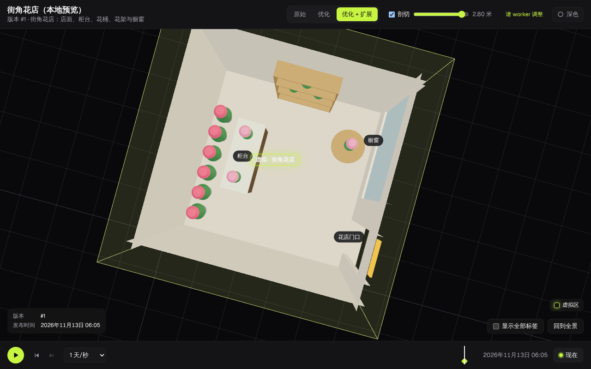
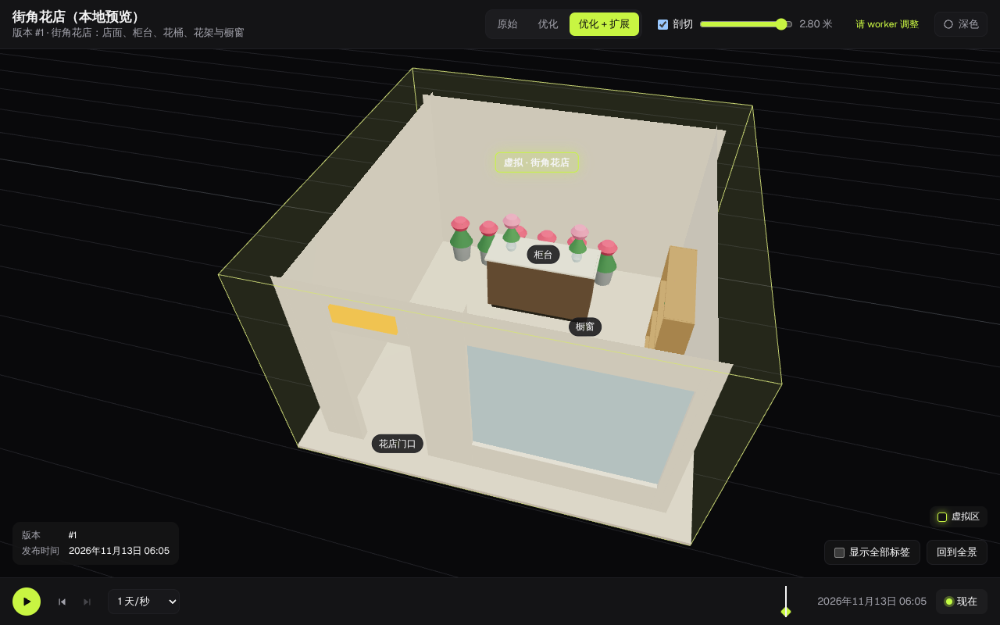

# 街角花店（flower-town）

一间 4.4 × 4.4 米的小花店，建在空间 `flower-town` 的地块 `shop`（5 × 5 米的虚拟区）里。它是查看器夹具里「街角花店」（`web/src/fixtures/florist.ts`）的真实版本：同样的布局、锚点和事件类型，用于 12-17 发布会的「来宾在花店订花篮、送到前厅」演示，以及之后给别的店铺照着建。

| 俯视 | 临街 |
|---|---|
|  |  |

## 里面有什么

- **结构**：整块地块铺 5 厘米地砖色方块作地台；北、西、东三面实墙（高 2.8、厚 0.12），南墙临街，西南角一扇门（宽 0.9、高 2.1），东侧一面橱窗（宽 2.2、台高 0.5、高 1.8，带玻璃）。
- **物件**：柜台（长 1.6、深 0.6、高 1.05，正面朝门）和台面上两束花；柜台后北墙一排六个花桶（模板 `bucket` 加六个实例）；东墙四层花架和三束花；橱窗里一张直径 0.8 米的圆桌展台和一束花；门上方的营业灯箱。花束是模板 `vase`，所有编号固定，重复 build 只更新不堆叠。
- **锚点**（都是公开的）：

| 锚点 | 类型 | 用途 |
|---|---|---|
| `counter` | `counter` | 柜台，`delivery.sent` 的起点 |
| `door` | `door` | 花店门口，组合里和前厅的门相连 |
| `window` | `zone` | 橱窗，陈列和营业状态 |

## 事件类型

`event-types/` 下是用 `metaverse admin register-event-type` 登记的文件，格式按设计 5.4：

| 空间 | 类型 | 显示 | 谁写 |
|---|---|---|---|
| `flower-town` | `order.placed` | 图标，5 秒 | 顾客专员接单时 |
| `flower-town` | `delivery.sent` | 路线起点，4 小时内有效 | 店主专员说「开始配送」时 |
| `flower-town` | `shop.status` | 状态类标签（营业中 / 已打烊），一天自动失效 | 店主专员 |
| `chronoai-lobby` | `delivery.arrived` | 路线终点，60 秒 | 店主专员确认送达时，用前厅发给花店的组织 key 写 |

送花一单两条事件用同一个 `correlationId`，格式 `flower-town:<订单号>`；前缀必须是起点空间的编号，别的空间伪造不了起点（设计第 12 节）。

## 本地怎么看

在仓库根目录先编好 SDK 和网站（`sdk/typescript`：`npm ci && npm run build`；`web`：`npm ci && npm run build`），然后在本目录：

```bash
npm run local-space   # 还没有线上空间时，按 layout.json 写出一个空的基础状态
npm run build         # 运行 build/main.ts，生成 out/ops.ndjson
npm run check         # 确认全部操作都落在地块 shop 内
npm run shot          # 无头浏览器截图到 out/shots/（需要 Chromium，默认 /opt/pw-browsers/chromium）
npm run dev           # 本地查看器
```

线上空间建好后改用 `metaverse pull`，它会用真实状态覆盖本地空状态；之后 `metaverse push --plot shop` 推成草稿、拿预览链接，人确认后 `metaverse publish`。

## 线上怎么建（空间主人或组织 admin 操作，不交给 agent key）

1. `metaverse admin create-space flower-town --name 街角花店 --owner-kind org --owner <ChronoAI 组织编号>`，保存返回的分享令牌。
2. `metaverse admin set-layout layout.json --message "划出花店地块"`。
3. 在花店空间逐个 `metaverse admin register-event-type event-types/flower-town/<文件>`；在前厅空间登记 `event-types/chronoai-lobby/delivery.arrived.json`。
4. 给建造用的 agent key 开放 `/spaces/flower-town/plots/shop/` 下的接口；给写事件的 key 开放 `POST /spaces/flower-town/sources/florist/events`；前厅发一把只开放 `POST /spaces/chronoai-lobby/sources/florist/events` 的组织 key 给花店。服务注册成目录服务并打开操作范围开关之前，这些 key 只能按服务限权，发布请由人操作。
5. 组合：`POST /api/v1/universes` 建「街角」，把 `chronoai-lobby` 和 `flower-town` 加进去，摆到前厅旁边，连接花店的 `door` 和前厅的 `counter-01`（前台，作收货台）。

## 尺寸依据

按 SDK 技能说明里的真实尺寸表：柜台高 1.05 深 0.6，门 0.9 × 2.1，墙厚 0.12 层高 2.8，花桶直径 0.28–0.34 高 0.36；主通道留 1.2 米以上。
