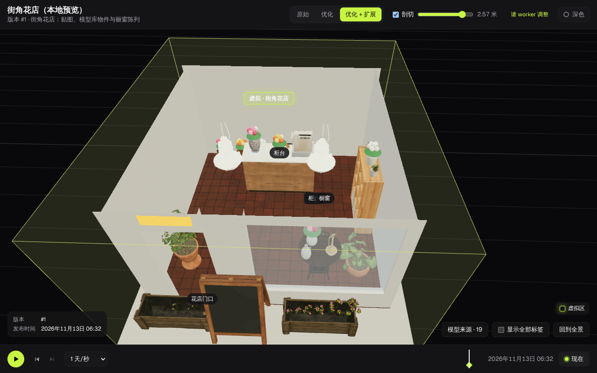

# 街角花店（flower-town）

一间 4.4 × 4.4 米的小花店，建在空间 `flower-town` 的地块 `shop`（5 × 5.5 米的虚拟区，南侧留 0.8 米街面）里。它是查看器夹具里「街角花店」（`web/src/fixtures/florist.ts`）的真实版本：同样的布局、锚点和事件类型，用于 12-17 发布会的「来宾在花店订花篮、送到前厅」演示，以及之后给别的店铺照着建。

| 临街 | 店内 | 俯视 |
|---|---|---|
|  |  |  |

## 里面有什么

- **结构**：整块地块铺 5 厘米浅灰方块作街面；店内地面是贴陶土地砖的薄板（按 2.08 米平铺，带法线和粗糙度）；北、西、东三面灰泥实墙（高 2.8、厚 0.12），南墙临街，西南角一扇门（宽 0.9、高 2.1），东侧一面橱窗（宽 2.2、台高 0.5、高 1.8，带玻璃）。墙和地面的贴图来自 Poly Haven（CC0），用 `shading: albedo` 完整受光。
- **柜台**：橡木贴图柜体、浅色台面、深色踢脚，长 1.6、深 0.6、高 1.05，正面朝门；台面上有收银机、青花瓶插花和一只发布会花篮样品。
- **模型库物件**（20 个，全部 Poly Haven CC0，见下表）：柜台后北墙一排六个木桶插花，东墙木格展示架上放多肉和瓷瓶，橱窗里的圆桌展台摆瓷瓶、黄铜瓶和一小丛酢浆草，门边一棵高盆栽、橱窗右侧一盆阔叶，两盏工业吊灯；街面上橱窗下和门边各一个木花箱（长春花、小黄花）和一块立式黑板。
- **参数形状**：花团是三个模板（粉、暖、白）的实例，插在桶、瓶、篮上；门上方的营业灯箱不受光照。所有编号固定，重复 build 只更新不堆叠。
- **锚点**（都是公开的）：

| 锚点 | 类型 | 用途 |
|---|---|---|
| `counter` | `counter` | 柜台，`delivery.sent` 的起点 |
| `door` | `door` | 花店门口，组合里和前厅的门相连 |
| `window` | `zone` | 橱窗，陈列和营业状态 |

### 模型来源（`build/authored.json`，署名随物件记录进 `props.source`）

| 模型 | 作者 | 许可 | 来源页 |
|---|---|---|---|
| Potted Plant 01 | Rico Cilliers | CC0-1.0 | [potted_plant_01](https://polyhaven.com/a/potted_plant_01) |
| Potted Plant 02 | Rico Cilliers | CC0-1.0 | [potted_plant_02](https://polyhaven.com/a/potted_plant_02) |
| Potted Plant 04 | James Ray Cock | CC0-1.0 | [potted_plant_04](https://polyhaven.com/a/potted_plant_04) |
| Planter Box 02 | James Ray Cock | CC0-1.0 | [planter_box_02](https://polyhaven.com/a/planter_box_02) |
| Periwinkle Plant | Amal Kumar | CC0-1.0 | [periwinkle_plant](https://polyhaven.com/a/periwinkle_plant) |
| Flower Empodium | Jenelle van Heerden, Rico Cilliers | CC0-1.0 | [flower_empodium](https://polyhaven.com/a/flower_empodium) |
| Flower Gazania | James Ray Cock, Jenelle van Heerden | CC0-1.0 | [flower_gazania](https://polyhaven.com/a/flower_gazania) |
| Shrub Sorrel 01 | Rico Cilliers | CC0-1.0 | [shrub_sorrel_01](https://polyhaven.com/a/shrub_sorrel_01) |
| Antique Ceramic Vase 01 | James Ray Cock | CC0-1.0 | [antique_ceramic_vase_01](https://polyhaven.com/a/antique_ceramic_vase_01) |
| Ceramic Vase 01 | James Ray Cock | CC0-1.0 | [ceramic_vase_01](https://polyhaven.com/a/ceramic_vase_01) |
| Ceramic Vase 02 | James Ray Cock | CC0-1.0 | [ceramic_vase_02](https://polyhaven.com/a/ceramic_vase_02) |
| Ceramic Vase 04 | James Ray Cock | CC0-1.0 | [ceramic_vase_04](https://polyhaven.com/a/ceramic_vase_04) |
| Brass Vase 02 | Rico Cilliers | CC0-1.0 | [brass_vase_02](https://polyhaven.com/a/brass_vase_02) |
| Wooden Display Shelves 01 | James Ray Cock | CC0-1.0 | [wooden_display_shelves_01](https://polyhaven.com/a/wooden_display_shelves_01) |
| Cash Register 01 | Joe Seabuhr | CC0-1.0 | [CashRegister_01](https://polyhaven.com/a/CashRegister_01) |
| Standing Chalkboard 01 | ParzivalCG | CC0-1.0 | [standing_chalkboard_01](https://polyhaven.com/a/standing_chalkboard_01) |
| Wooden Bucket 01 | James Ray Cock | CC0-1.0 | [wooden_bucket_01](https://polyhaven.com/a/wooden_bucket_01) |
| Wicker Basket 02 | Kuutti Siitonen | CC0-1.0 | [wicker_basket_02](https://polyhaven.com/a/wicker_basket_02) |
| Hanging Industrial Lamp | Kuutti Siitonen | CC0-1.0 | [hanging_industrial_lamp](https://polyhaven.com/a/hanging_industrial_lamp) |
| Round Wooden Table 02 | Ulan Cabanilla | CC0-1.0 | [round_wooden_table_02](https://polyhaven.com/a/round_wooden_table_02) |

模型用 `metaverse-recon fetch` 下载、`metaverse-recon models` 按物件模型的上限导出（减面、缩贴图、原点放到底面中心），结果在 `build/models/models.json`（哈希、包围盒、三角形数）；glb 本身不进版本库，按下面的命令可以重新生成。

### 贴图来源（`build/textures.json`）

| 贴图 | 作者 | 许可 | 来源页 | 实际尺寸 |
|---|---|---|---|---|
| Oak Wood Planks | Dimitrios Savva | CC0-1.0 | [oak_wood_planks](https://polyhaven.com/a/oak_wood_planks) | 1.2 × 1.2 米 |
| Terracotta Floor Tiles | Dimitrios Savva | CC0-1.0 | [terracotta_floor_tiles](https://polyhaven.com/a/terracotta_floor_tiles) | 2.08 × 2.08 米 |
| White Stucco | Amal Kumar | CC0-1.0 | [white_stucco](https://polyhaven.com/a/white_stucco) | 1.998 × 1.998 米 |

贴图用 `metaverse-recon texfetch` 下载（颜色、法线、粗糙度各一张，1k），按内容哈希放在工作区 `assets/`。

## 事件类型

`event-types/` 下是用 `metaverse admin register-event-type` 登记的文件，格式按设计 5.4：

| 空间 | 类型 | 显示 | 谁写 |
|---|---|---|---|
| `flower-town` | `order.placed` | 图标，5 秒 | 顾客专员接单时 |
| `flower-town` | `delivery.sent` | 路线起点，4 小时内有效 | 店主专员说「开始配送」时 |
| `flower-town` | `shop.status` | 状态类标签（营业中 / 已打烊），一天自动失效 | 店主专员 |
| `chronoai-lobby` | `delivery.arrived` | 路线终点，60 秒 | 店主专员确认送达时，用前厅发给花店的组织 key 写 |

送花一单两条事件用同一个 `correlationId`，格式 `flower-town:<订单号>`；前缀必须是起点空间的编号，别的空间伪造不了起点（设计第 12 节）。

## 本地怎么看

在仓库根目录先编好 SDK 和网站（`sdk/typescript`：`npm ci && npm run build`；`web`：`npm ci && npm run build`），装好重建工具（`recon`：`uv venv .venv && uv pip install -e .`），然后在本目录：

```bash
npm run local-space   # 还没有线上空间时，按 layout.json 写出一个空的基础状态
# 取模型和贴图（需要能访问 api.polyhaven.com、dl.polyhaven.org）：
for id in $(python3 -c "import json;print(' '.join(e['props']['source']['id'] for e in json.load(open('build/authored.json'))['entities']))"); do
  ../../recon/.venv/bin/metaverse-recon fetch --library polyhaven --id $id --resolution 1k; done
../../recon/.venv/bin/metaverse-recon models --authored build/authored.json --out build/models
python3 - <<'PY'   # 导出的 glb 按完整哈希放进 assets/
import json,shutil
r=json.load(open('build/models/models.json'))
for sha,i in r['files'].items(): shutil.copyfile(f"build/models/{i['file']}", f"assets/{sha}.glb")
PY
for id in terracotta_floor_tiles white_stucco oak_wood_planks; do
  ../../recon/.venv/bin/metaverse-recon texfetch --library polyhaven --id $id --resolution 1k --out /tmp/tex/$id; done
# 把 /tmp/tex/*/color|normal|roughness.jpg 按 sha256 复制成 assets/<哈希>.jpg（build/textures.json 里是哈希）
npm run build         # 运行 build/main.ts，生成 out/ops.ndjson
npm run check         # 确认全部操作都落在地块 shop 内
npm run shot          # 无头浏览器截图到 out/shots/（需要 Chromium，默认 /opt/pw-browsers/chromium）
npm run dev           # 本地查看器
```

线上空间建好后改用 `metaverse pull`，它会用真实状态覆盖本地空状态；模型和贴图要先经 `metaverse edit upload` 上传核对（编辑计划的 `assets` 列出哈希、格式和本地路径），再 `metaverse push --plot shop` 推成草稿、拿预览链接，人确认后 `metaverse publish`。

## 线上怎么建（空间主人或组织 admin 操作，不交给 agent key）

1. `metaverse admin create-space flower-town --name 街角花店 --owner-kind org --owner <ChronoAI 组织编号>`，保存返回的分享令牌。
2. `metaverse admin set-layout layout.json --message "划出花店地块"`。
3. 在花店空间逐个 `metaverse admin register-event-type event-types/flower-town/<文件>`；在前厅空间登记 `event-types/chronoai-lobby/delivery.arrived.json`。
4. 给建造用的 agent key 开放 `/spaces/flower-town/plots/shop/` 下的接口；给写事件的 key 开放 `POST /spaces/flower-town/sources/florist/events`；前厅发一把只开放 `POST /spaces/chronoai-lobby/sources/florist/events` 的组织 key 给花店。服务注册成目录服务并打开操作范围开关之前，这些 key 只能按服务限权，发布请由人操作。
5. 组合：`POST /api/v1/universes` 建「街角」，把 `chronoai-lobby` 和 `flower-town` 加进去，摆到前厅旁边，连接花店的 `door` 和前厅的 `counter-01`（前台，作收货台）。

## 尺寸依据

按 SDK 技能说明里的真实尺寸表：柜台高 1.05 深 0.6，门 0.9 × 2.1，墙厚 0.12 层高 2.8，花桶直径 0.28–0.34 高 0.36；主通道留 1.2 米以上。
